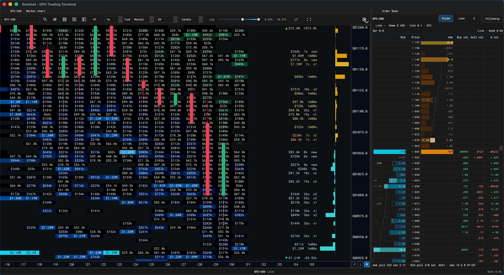
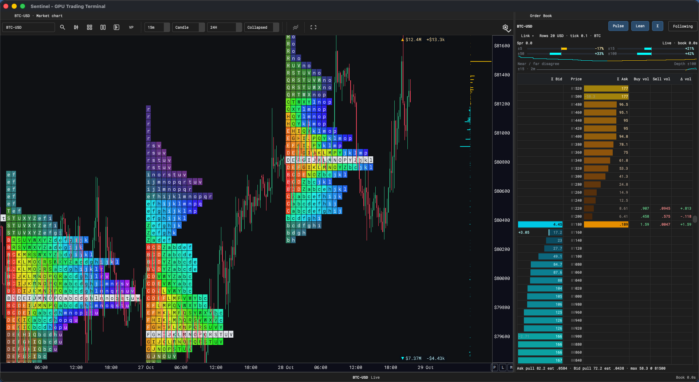
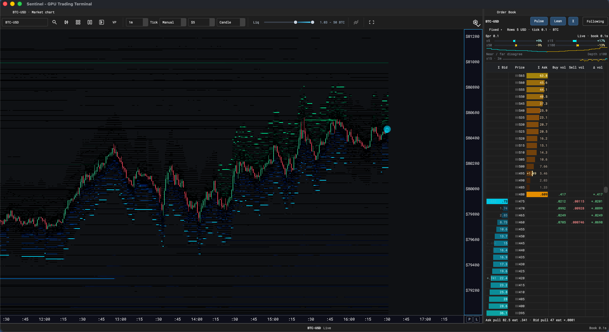
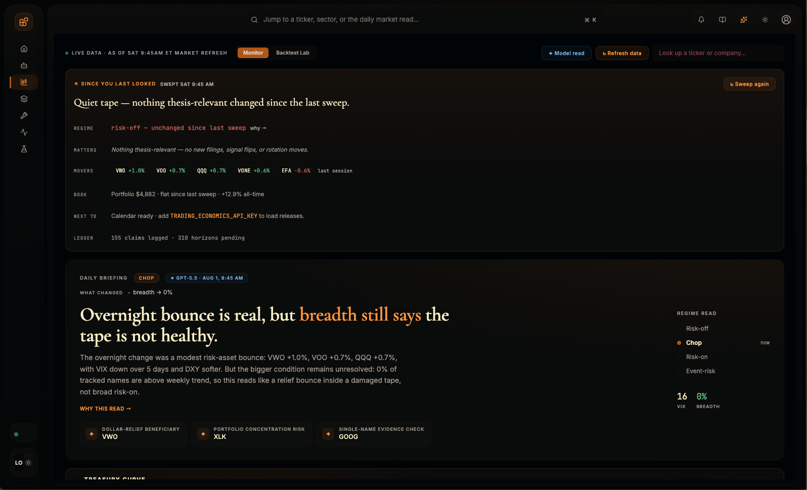
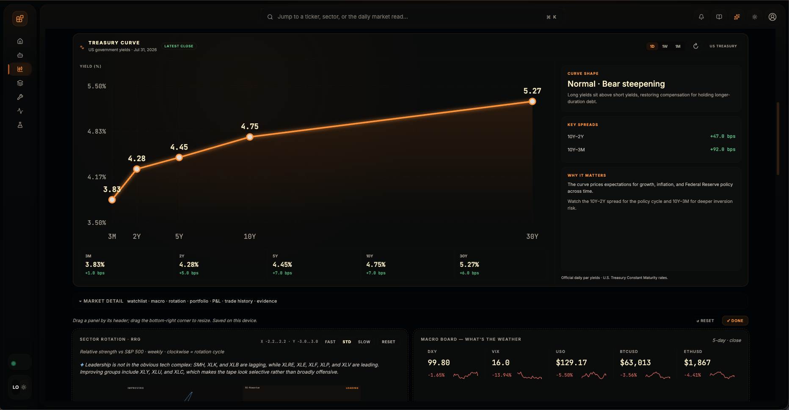
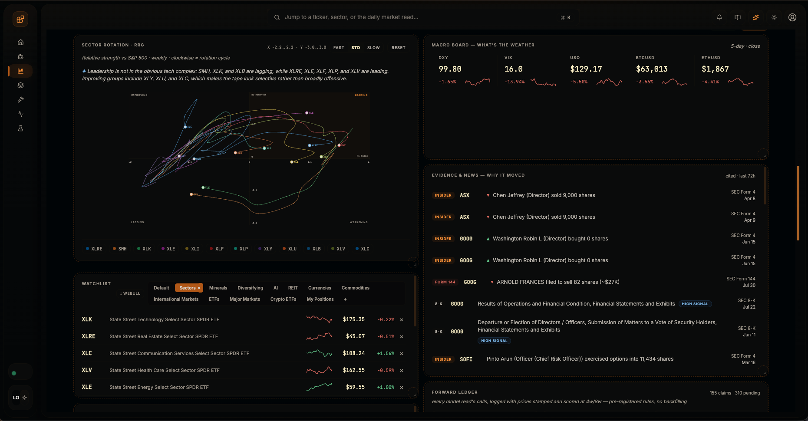

# Pat

I build stuff for fun and bring ideas I have to life. :D

Right now I'm focused on [Sentinel](https://github.com/pattty847/Sentinel): a GPU-rendered order-flow terminal for Coinbase spot markets, written in C++20 and Qt 6.

## Main Projects

- [Sentinel](https://github.com/pattty847/Sentinel)  
  My main focus right now. Sentinel records the full level 2 order book and trade tape of the products I choose, keeps it as a gap-aware history, and draws it live as an order book heatmap with candles, footprint, TPO and volume profile layers. It runs around the clock on my Mac and records seven products.

  

    
  

  
BTC-USD live: heatmap with dollar size labels, candles, and the Order Book dock

  

  
More Sentinel: TPO profiles, recorded history

  

    
     TPO: 24-hour sessions over 15m candles, one letter per period, coloured by time
      
    
     Hours of recorded heatmap history, Order Book dock in cumulative (Σ) mode
  

  

  **What's in it:**

  - **Recording** — a capture service writes every Coinbase level 2 and trade frame to a checksummed journal; the server rolls it into one-minute heatmap history.
  - **GPU rendering** — the heatmap, ladder and chart layers draw through Qt's scene graph on Metal, D3D12 or Vulkan, so the view stays at frame rate while the feed is busy.
  - **Order Book dock** — Pulse, Lean and cumulative (Σ) modes, grouped rows, wall tracking.
  - **Stock chart and screener** — SEC Form 4 insider transactions overlaid on price.
  - **Paper trading only** — market and limit orders, positions and PnL on the server. It never sends a real order.

- [CopeNet](https://github.com/pattty847/CopeNet)  
  A local-first agent operator workspace: persistent sessions, tool calling, runtime inspection, and provider and model comparisons across LM Studio, Ollama, Codex CLI and Claude CLI. Frontier models do the reasoning; sessions, transcripts and control stay local.

  

    
  

  
Market Monitor: a daily brief backed by live SEC filings and a self-scoring forward ledger

  

  
More CopeNet: features, treasury curve, sector rotation

  - **Agents Console** — persistent sessions with an inline runtime inspector, first-send provider/profile lock, tool chips attached per turn, and export/copy modes that separate the conversation from tool receipts.
  - **Fleet Rooms** — a durable multi-model room where ChatGPT and Claude answer the same prompt independently behind a reveal barrier, then critique each other's claims in attributed follow-ups instead of just agreeing with each other.
  - **Market Monitor** — a daily model-generated brief on your watchlist: live SEC filings (Form 4, Form 144, 8-K), sector rotation (RRG), an accumulation watch, financial-series overlays (revenue/P/E over split-adjusted price), and the U.S. Treasury curve. Every call the model makes is pre-registered to a forward ledger and scored later — no backfilling the read after the fact.
  - **Access & Permissions** — a trust axis separate from behavior: Read-only, Ask (pauses for approval off an allowlist), or Full Access, gated to trusted frontier providers, with inline approve/reject/always-allow cards on desktop and mobile.
  - **Observability** — run pulse, recent traces, provider/tool distribution, and per-session activity, so a run stays inspectable instead of turning into opaque chat history.
  - **Persona Home** — editable identity per model (`SOUL.md`, `IDENTITY.md`, `USER.md`), including having a model author its own persona on request.
  - **Experiments** — provider × model comparisons in one place for speed, tool behavior, and prompt-following drift.
  - **Mobile-friendly remote access** over Tailscale, token-gated beyond localhost.

  

    
      
    
  

  

## Selected Work

- [Trade-Suite-v2](https://github.com/pattty847/Trade-Suite-v2)  
  A rebuilt version of my trading workstation, recently revamped with PySide. Scanners, filings, market tooling, and the foundation for a lot of the ideas I still care about.

- [Trade-Suite](https://github.com/pattty847/Trade-Suite)  
  The earlier version that started the whole trading-terminal path.

- [Crypto-Market-Watch](https://github.com/pattty847/Crypto-Market-Watch)  
  Crypto market monitoring and whale and CVD-focused tooling.

## What I'm Into

- trading terminals and market microstructure
- GPU rendering and low-latency market data
- local-first AI systems
- agent workflows and tool calling
- building software that feels fast, inspectable, and real

## Activity

  
  

